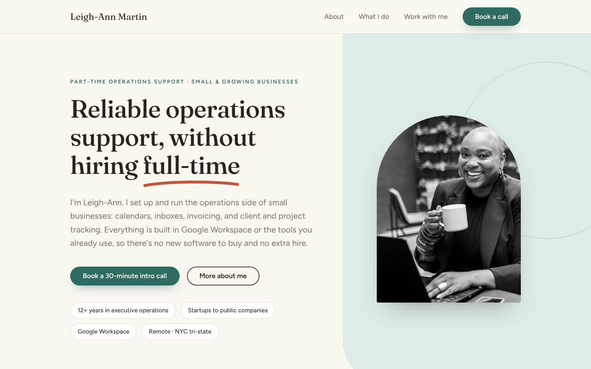
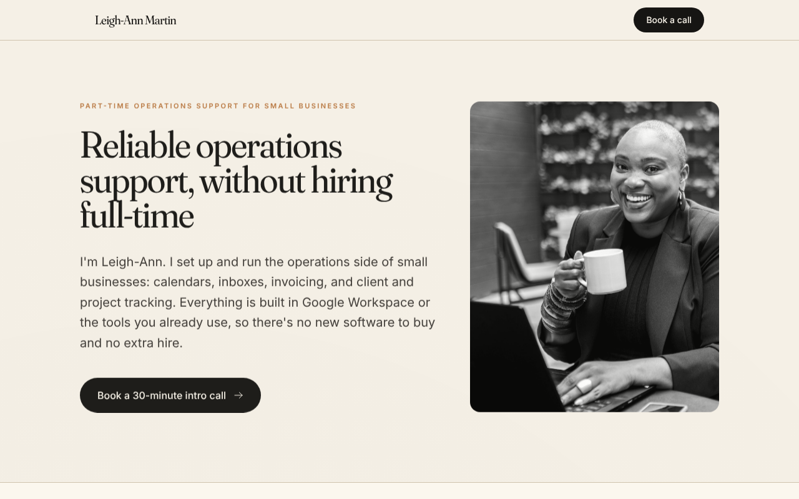
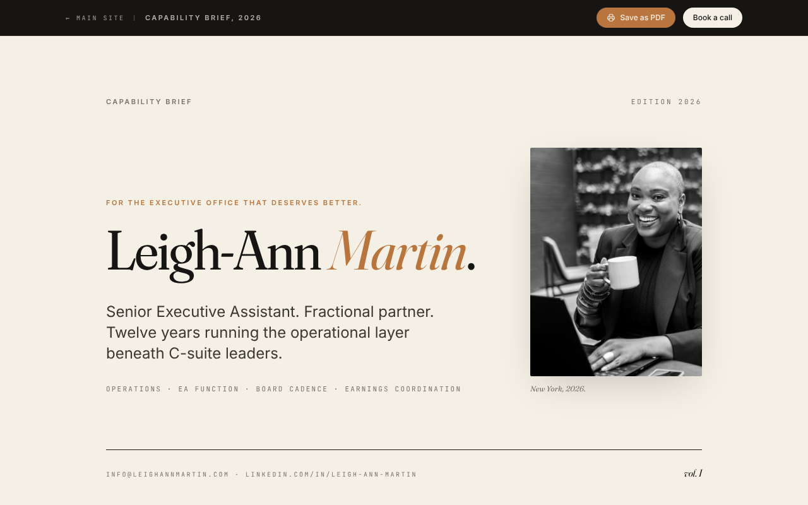
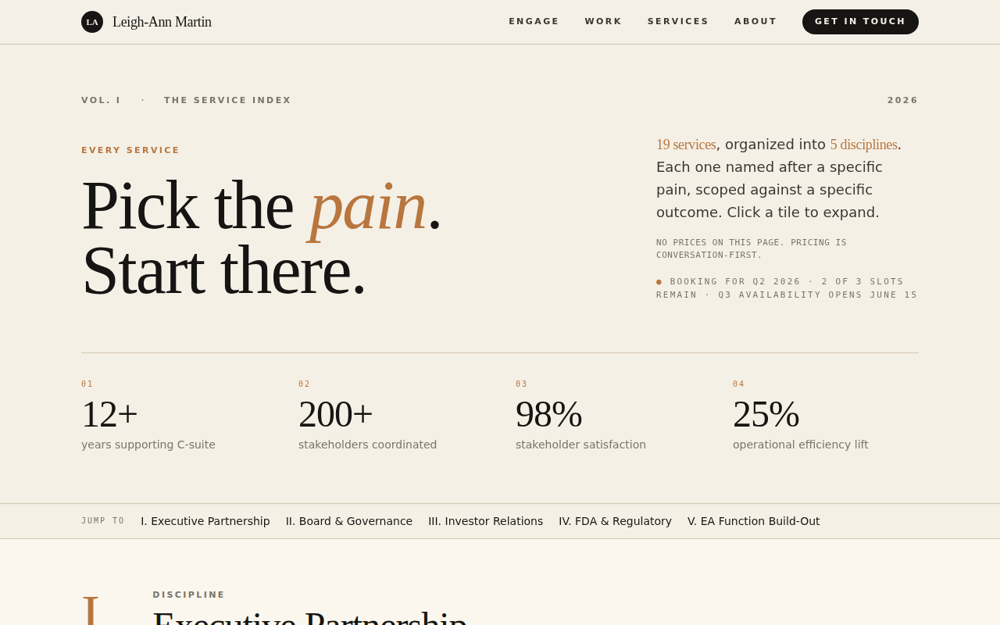
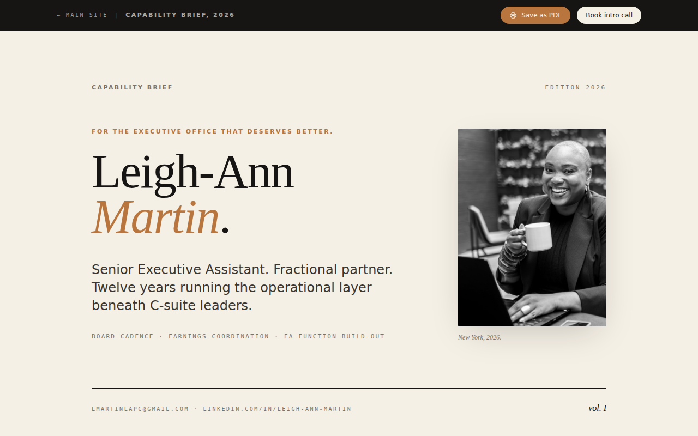
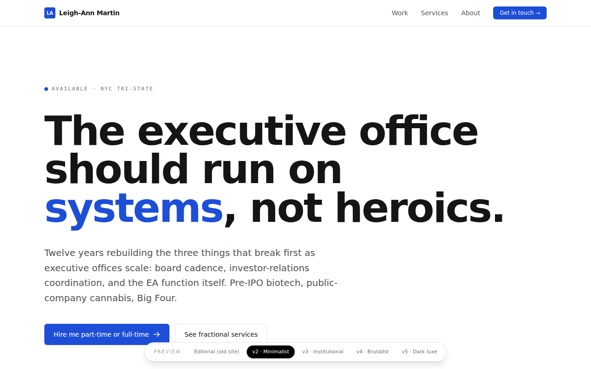
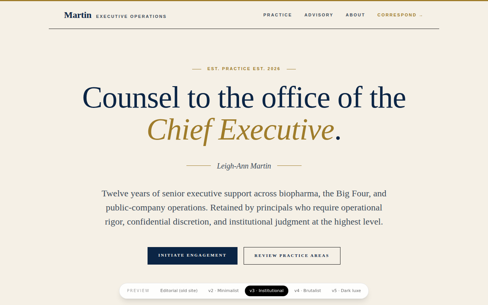

# Leigh-Ann Martin — services site

Astro + Tailwind static site, deployed to GitHub Pages on every push to `main`.

**Live base URL:** https://izzydoesizzy.github.io/leigh-ann-services/
**Start here (for Leigh-Ann):** https://izzydoesizzy.github.io/leigh-ann-services/review
**Page directory (in the browser):** https://izzydoesizzy.github.io/leigh-ann-services/archive
**Intake form (every Book a call button):** https://docs.google.com/forms/d/1NiMiUdhcx3ph5VCF6yI_nZJgvUZbihtdkXCPmrCju1E/viewform
**Contact email used on every page:** info@leighannmartin.com

The repo holds several versions of the site side by side. This file is the map. Every page below has a header screenshot (first screen at 1280px) and a full-page screenshot in [`docs/screenshots/`](docs/screenshots/). Click any full-page thumbnail to open it at full size.

---

## 1. Main site (Teal & Clay)

The simplified one-page site, built in October 2026 from Leigh-Ann's outline: hero, about, core skills, who she works with, industries, two case studies, done by / with / for you, 1–3 month engagement terms, and a single **Book a call** button. No pricing on the page (pricing lives in the intake form). Since November 2026 the **Teal & Clay** theme is the main look; the Editorial-theme versions are archived (section 4).

| | |
|---|---|
| **Live** | https://izzydoesizzy.github.io/leigh-ann-services/ |
| **Source** | `src/pages/index.astro` |
| **Theme** | Teal & Clay: ivory, sage colour block, teal accent, one clay flourish. Fraunces + Figtree. Ported from Variation C of the `leigh-ann-ea` repo's `/v10/heroes` explorations. |
| **Look** | Arch-shaped portrait, stat pills under the hero, cards for skills and case studies, sage band for packages, dark footer. |
| **Indexed** | Yes |
| **Screenshot** | [](docs/screenshots/home-full.jpg) |

Every **Book a call** button on the site goes to the Google intake form. The link is set once, as `BOOK_URL` in `src/data/capability-brief.ts`.

**Hero heading.** Leigh-Ann chose "Reliable operations support, without hiring full-time" in November 2026, so the heading picker is gone. The heading and lead paragraph live in `src/data/headings.ts`. The share image uses the same headline, hard-coded in `scripts/og/template.html`.

**Old preview URLs.** `/new` and `/new/capability-brief` redirect to `/` and `/capability-brief` (set in `astro.config.mjs`), in case anyone has the old links.

---

## 2. Capability brief (updated November 2026)

A long-form brief to send to prospects, also printable to PDF with the **Save as PDF** button. Rebuilt in November 2026 from Leigh-Ann's voice note, her "Cap Briefing Updates" doc, and the Oct 1 and Nov 7 calls.

| | |
|---|---|
| **Live** | https://izzydoesizzy.github.io/leigh-ann-services/capability-brief |
| **Source** | `src/pages/capability-brief.astro` |
| **Theme** | Teal & Clay, matches `/` |
| **Indexed** | Yes |
| **Screenshot** | [](docs/screenshots/capability-brief-full.jpg) |

**All the copy lives in one file:** `src/data/capability-brief.ts`. It holds the bio, At a glance, stats, case studies, packages, process steps, credentials, the email address and the booking link. Testimonials come from `src/data/pull-quotes.ts`. The archived Editorial version of the brief reads the same file, so an edit there updates both.

**Chapters:**

1. **About**: Leigh-Ann's bio and an At a glance panel.
2. **By the numbers**: eight headline metrics.
3. **Selected work**: To Be Hosted (fractional EA and operations, current client), then Ascend board cadence, Immunovant EA function, and Ascend earnings prep.
4. **How clients describe me**: one feature quote from Pam Connealy, four short quotes, and a closer. Only Pam's is live on LinkedIn; the rest are anonymised by role.
5. **Ways to work together**: done by you, done with you, done for you, plus the four disciplines (operations, executive partnership, board and governance, investor relations). No prices, by decision.
6. **How I work**: intake form, discovery call, scope, kickoff, handoff or ongoing.
7. **Credentials**
8. **Next steps**: Book a call (intake form) or email.

**Placeholders waiting on Leigh-Ann** (also listed on `/review`):
- The To Be Hosted metrics panel ("Founder + 4 / Google Workspace / Admin to proposals"), and her title there.
- The new LinkedIn recommendations she wants added.
- Whether to keep the "Resume-backed metrics…" line in chapter 2.
- The cover line and the "Open to" line, which may no longer fit.
- An expected date for the Salesforce certification.

---

## 3. Review page for Leigh-Ann

| | |
|---|---|
| **Live** | https://izzydoesizzy.github.io/leigh-ann-services/review |
| **Source** | `src/pages/review.astro` |
| **Theme** | Teal & Clay. Not indexed. |
| **Screenshot** | [](docs/screenshots/review-full.jpg) |

One page to send her: links to the brief, the homepage, the intake form and the archived versions, a list of what changed, and the open questions. The lists are plain arrays at the top of the file, so update them each review round.

---

## 4. Editorial theme (archived November 2026)

The same homepage and brief in the original **Editorial** look: ivory paper, near-black ink, copper accent, Fraunces + Inter. Replaced as the main look by Teal & Clay and moved under `/archive/editorial/`. Both are noindex.

| | Homepage | Capability brief (Nov 2026 update) |
|---|---|---|
| **Live** | https://izzydoesizzy.github.io/leigh-ann-services/archive/editorial/simplified | https://izzydoesizzy.github.io/leigh-ann-services/archive/editorial/capability-brief-2026-11 |
| **Source** | `src/pages/archive/editorial/simplified.astro` | `src/pages/archive/editorial/capability-brief-2026-11.astro` |
| **Header** |  |  |
| **Full page** | [Full page](docs/screenshots/editorial-simplified-full.jpg) | [Full page](docs/screenshots/editorial-capability-brief-2026-11-full.jpg) |

The archived brief reads `src/data/capability-brief.ts` like the main one, so copy edits show up in both. The archived homepage still has its own inline copy and reads the hero from `src/data/headings.ts`.

---

## 5. Previous long-form site (editorial)

The long-form fractional-EA site that was the homepage until October 2026, aimed at pre-IPO and public-company executives: personas, four engagement tiers, case studies with metrics, a skills matrix, FAQ, press. Kept intact under `/archive/editorial/` with its three subpages (the Nov 2026 Editorial pages above live alongside them). All noindex.

| Page | Live | Source | What it is |
|---|---|---|---|
| Homepage | https://izzydoesizzy.github.io/leigh-ann-services/archive/editorial | `src/pages/archive/editorial/index.astro` | 17 sections. Assembled from the components in `src/components/editorial/`. |
| Services index | https://izzydoesizzy.github.io/leigh-ann-services/archive/editorial/services | `src/pages/archive/editorial/services.astro` | Catalogue of 37 services across disciplines. Linked from the editorial homepage. |
| Packages | https://izzydoesizzy.github.io/leigh-ann-services/archive/editorial/packages | `src/pages/archive/editorial/packages.astro` | Priced packages. Deliberately unlinked; shared only after a discovery call. |
| Capability brief | https://izzydoesizzy.github.io/leigh-ann-services/archive/editorial/capability-brief | `src/pages/archive/editorial/capability-brief.astro` | The brief as it was before the November 2026 update, frozen. Has its own copy inline; it does not read `src/data/capability-brief.ts`. The current brief is section 2; the Nov 2026 Editorial version is section 4. |

| Homepage | Services index |
|---|---|
|  |  |
| [Full page](docs/screenshots/editorial-home-full.jpg) (very long) | [Full page](docs/screenshots/editorial-services-full.jpg) |

| Packages | Capability brief |
|---|---|
|  |  |
| [Full page](docs/screenshots/editorial-packages-full.jpg) | [Full page](docs/screenshots/editorial-capability-brief-full.jpg) |

---

## 6. Style mockups

Four alternative looks for the previous site, built to pick a visual direction. Content is a trimmed copy of the editorial homepage, so only the styling differs. Each has a floating "Preview" switcher at the bottom to jump between them. All noindex.

| Mockup | Live | Source | Look |
|---|---|---|---|
| Minimalist | https://izzydoesizzy.github.io/leigh-ann-services/archive/mockups/minimalist | `src/pages/archive/mockups/minimalist.astro` | White, Inter, hairlines. Quiet product-site feel. |
| Institutional | https://izzydoesizzy.github.io/leigh-ann-services/archive/mockups/institutional | `src/pages/archive/mockups/institutional.astro` | Navy, gold, serif. Law-firm / advisory feel. |
| Brutalist | https://izzydoesizzy.github.io/leigh-ann-services/archive/mockups/brutalist | `src/pages/archive/mockups/brutalist.astro` | Black, bone, mono. Heavy rules, uppercase, grid. |
| Dark luxe | https://izzydoesizzy.github.io/leigh-ann-services/archive/mockups/dark-luxe | `src/pages/archive/mockups/dark-luxe.astro` | Near-black, gold. High-contrast luxury feel. |

| Minimalist | Institutional |
|---|---|
|  |  |
| [Full page](docs/screenshots/mockup-minimalist-full.jpg) | [Full page](docs/screenshots/mockup-institutional-full.jpg) |

| Brutalist | Dark luxe |
|---|---|
|  |  |
| [Full page](docs/screenshots/mockup-brutalist-full.jpg) | [Full page](docs/screenshots/mockup-dark-luxe-full.jpg) |

---

## Change log

**November 2026**
- Made the Teal & Clay theme the main site: `/` and `/capability-brief` are now Teal & Clay. The Editorial versions moved to `/archive/editorial/simplified` and `/archive/editorial/capability-brief-2026-11` (noindex). `/new` and `/new/capability-brief` redirect to the new addresses. The archive directory, `/review` and the screenshots were updated to match.
- Leigh-Ann chose hero heading 1. Removed the heading picker from the homepage and deleted the unused heading.
- Small wording edits from her highlighted doc: "started at age 18", "event management industries", and "I manage" the To Be Hosted trackers.
- Restored `/capability-brief`, which went missing when the October reorganisation moved the old brief to `/archive/editorial/capability-brief`.
- Rewrote the brief from Leigh-Ann's notes and calls (see section 2): new bio, To Be Hosted case study, simpler testimonials, packages instead of the 37-service catalog, new process, updated credentials. Removed "Four shapes of fractional" and "In the press".
- Added a Teal & Clay version of the brief and moved the brief's copy into `src/data/capability-brief.ts` so both versions share it.
- Every **Book a call** button on the homepage and both briefs now goes to the Google intake form instead of Calendly. The archived pages still link to Calendly.
- Replaced the old Gmail address with info@leighannmartin.com on every page, archive included.
- Added the `/review` start page for Leigh-Ann.

**October 2026**
- Simplified one-page site became the homepage; `/new` added in the Teal & Clay theme.
- Everything older moved under `/archive` (see Old slugs below).
- Heading picker and share images added to `/` and `/new`. (Picker removed in November once Leigh-Ann chose heading 1.)

---

## Old slugs

Slugs were flattened out in October 2026 and the main theme swapped in November 2026. If you have an old link:

| Old | Now |
|---|---|
| `/` (previous long-form homepage, until Oct 2026) | `/archive/editorial` |
| `/services` | `/archive/editorial/services` |
| `/packages` | `/archive/editorial/packages` |
| `/capability-brief` (pre-Nov 2026) | `/archive/editorial/capability-brief`. `/capability-brief` is now the updated Teal & Clay brief. |
| `/new` (Teal & Clay preview) | `/` (redirects) |
| `/new/capability-brief` | `/capability-brief` (redirects) |
| `/v2` (mockup) | `/archive/mockups/minimalist` |
| `/v3` | `/archive/mockups/institutional` |
| `/v4` | `/archive/mockups/brutalist` |
| `/v5` | `/archive/mockups/dark-luxe` |

---

## Repo layout

```
src/
  pages/
    index.astro                  /                       main site, teal & clay theme
    capability-brief.astro       /capability-brief       capability brief, teal & clay theme
    review.astro                 /review                 start page for Leigh-Ann: links, changes, questions
    archive/
      index.astro                /archive                directory of every page
      editorial/                 /archive/editorial/…    previous long-form site + subpages, plus the archived
                                                         Editorial-theme homepage (simplified) and brief (capability-brief-2026-11)
      mockups/                   /archive/mockups/…      four style mockups
  layouts/
    EditorialLayout.astro        loads styles/editorial.css (used by archive/editorial, mockups)
    TealLayout.astro             loads styles/teal.css     (used by /, /capability-brief, /review, /archive)
  styles/
    editorial.css                ivory / ink / copper tokens, Fraunces + Inter
    teal.css                     ivory / sage / teal / clay tokens, Fraunces + Figtree
  components/
    editorial/                   sections of the previous site (Masthead, Overture, TwoPaths, …)
    mockups/VariantSwitcher.astro
  data/
    capability-brief.ts          all copy for the capability brief (main and archived), plus BOOK_URL and EMAIL used site-wide
    headings.ts                  hero heading + lead paragraph for the homepage
    pull-quotes.ts               anonymised testimonials used by the briefs and editorial pages
public/portrait.jpg              the one portrait every version uses
docs/screenshots/                header (PNG) + full-page (JPG) shots of every page
```

The two stylesheets are independent: each imports Tailwind and declares its own `@theme`, so a page only ever gets the tokens of the layout it uses.

## Working on it

```
pnpm install
pnpm dev        # http://localhost:4321/leigh-ann-services/
pnpm build      # output in dist/
```

Pushing to `main` deploys everything in `dist/` to GitHub Pages via `.github/workflows/deploy.yml`. Work on a branch and merge when ready.

**Share images** (the preview card when a link is pasted into LinkedIn, iMessage, Slack, etc.): `public/og-new.png` is the card for the main site (`/`, `/capability-brief`, `/review`, `/archive`) and `public/og.png` is used by the archived Editorial pages, both 1200×630. (`og-new.png` kept its name from when Teal & Clay was the `/new` preview.) They're rendered from `scripts/og/template.html` with `node scripts/og/render.mjs` (needs Playwright). The headline is hard-coded in the template and already matches the chosen heading; if the heading ever changes, update it there, re-run, and commit the PNGs. Add `--all` to dump the other four concepts into `scripts/og/out/`.

**Refreshing the screenshots** after a visual change: run `pnpm build && pnpm preview`, then take a 1280px-wide header shot (800px tall viewport) and a full-page JPEG for each page and drop them in `docs/screenshots/` using the existing names.

**Adding a page:** put it under `src/pages/`, add a row to the `/archive` directory (`src/pages/archive/index.astro`) and to this README, and add its screenshots.
